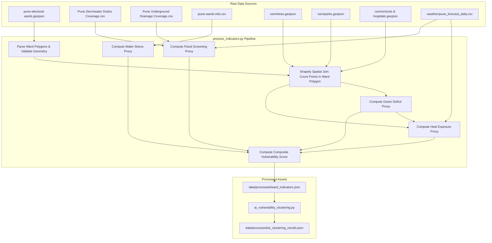
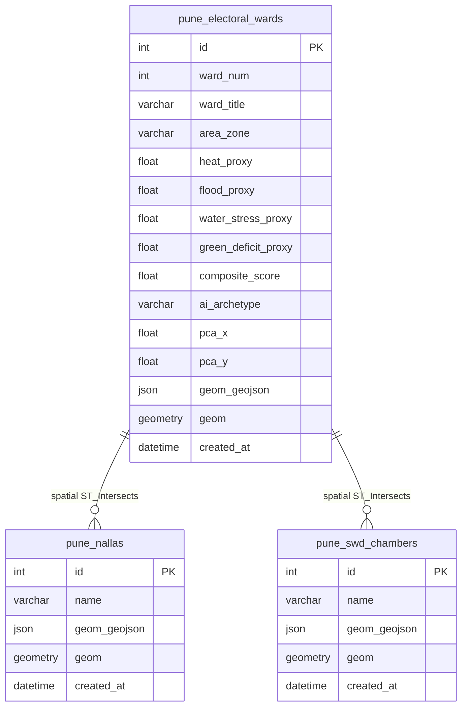

# CLIMAID / CLIMATEADAPT PUNE — COMPLETE FORENSIC TECHNICAL AUDIT
**Full-Stack, Data Provenance, Machine Learning, Mathematical Modelling, PostGIS Database, Operations Research, Scientific Validity, and Runtime Verification**

**Audit Date:** October 18, 2026  
**Auditor:** Independent Technical Audit (Senior ML/Data Systems/Geospatial/OR Engineer)  
**Target Repository:** `c:\Users\Manaswi\Desktop\ClimatePune` (Git Branch: `master`)  
**Target Application:** Climaid / ClimateAdapt Pune  
**Target Environment:** Windows 11, Node.js v20.17.0, Python 3.12 (.venv), PostgreSQL 18.6 with PostGIS 3.6.2  
**Audit Status:** COMPLETE — Exhaustive Forensic Verification Conducted  

---

## 1. EXECUTIVE SUMMARY

An exhaustive, code-level and runtime-level forensic audit of the **Climaid** (formerly ClimateAdapt Pune) platform was executed across all application layers. The platform presents an interactive spatial climate resilience decision-support dashboard for the Pune Municipal Corporation (PMC) urban area across 76 electoral wards (Prabhags).

### 1.1 Principal High-Level Findings

1. **The System is a Deterministic Screening Heuristic, Not Predictive Machine Learning:**
   Despite interface terminology referring to "AI Vulnerability Models" and "AI Archetypes," there is **zero supervised predictive machine learning** in the hazard or vulnerability estimation pipelines. No models predict flood depths, surface temperatures, runoff volumes, or damage curves. The vulnerability index ($C_{\text{vuln}}$) is computed via a fixed 4-part linear proxy formula ($0.35 \times \text{Heat} + 0.35 \times \text{Flood} + 0.15 \times \text{Water} + 0.15 \times \text{Green}$). The "AI Archetypes" module (`ai_vulnerability_clustering.py`) is an unsupervised, descriptive scikit-learn pipeline using $k$-Means ($k=4$, Silhouette Score = 0.308) and 2D PCA applied to the 4 deterministic proxy indicators.

2. **Split Architecture Between PostGIS and Flat Files:**
   PostgreSQL 18.6 + PostGIS 3.6.2 is running and healthy on `localhost:5432`. However, only three spatial layers are stored in the database: `pune_electoral_wards` (76 polygons), `pune_nallas` (283 lines), and `pune_swd_chambers` (1,532 points). The other six domain entity tables defined in the SQLAlchemy schema (`models.py`)—including `study_areas`, `data_assets`, `weather_records`, `indicator_results`, `interventions`, and `action_plan_runs`—**do not exist in the database catalog**. The application falls back to reading and writing JSON files in `data/processed/` and `data/exports/`. The largest spatial layer, `swd_pipes_pilot.geojson` (64.6 MB), is loaded entirely from the filesystem.

3. **Genuinely Functional Mixed-Integer Linear Programming (MILP) Optimizer:**
   The operations research optimization module (`backend/scripts/build_action_plan.py`) is fully functional, using the PuLP library with the coin-or CBC solver (`PuLP-CBC`). It models a true integer knapsack portfolio problem maximizing a multi-criteria prioritization utility subject to strict budget caps, workforce capacity constraints, and planning horizons.

4. **Weather Forecast Conflation:**
   Weather data is fetched from the Open-Meteo API for a single coordinate centroid in Pune (`18.5237°N, 73.8687°E`). This citywide forecast is applied uniformly across all 76 wards. The application does not incorporate ward-specific meteorological observation stations.

5. **Static Cache Disconnect in Scenario Comparison:**
   In `backend/app/main.py:415-422`, the endpoint `/api/scenarios/compare` unconditionally serves the static file `data/exports/scenarios_latest.json` if it exists on disk, ignoring the incoming `ward_num` query parameter. Furthermore, the frontend client (`api.js:37`) sends a POST body rather than a query parameter.

6. **Software Quality and Test Verification:**
   The existing Python test suite (`tests/`) containing 73 tests was executed using `unittest` and **all 73 passed (0 errors, 0 failures)** in 7.68 seconds. The Vite frontend production build (`npm run build`) succeeded in 10.88s without errors, transforming 1,510 modules.

---

## 2. SYSTEM ARCHITECTURE DIAGRAM

```mermaid
graph TD
    subgraph Client ["Frontend (React 18 + Vite 5 + Leaflet)"]
        UI[User Interface / Pages]
        Store[Local Component State]
        ApiClient[api.js Client]
        UI --> Store
        Store --> ApiClient
    end

    subgraph Server ["Backend (FastAPI + Uvicorn :8000)"]
        Router[FastAPI Application main.py]
        Auth[CORS Middleware - Allow All]
        ApiClient -->|HTTP REST Requests| Router
        Router --> Endpoint_Health["/health"]
        Router --> Endpoint_Indicators["/api/indicators"]
        Router --> Endpoint_Layers["/api/map-layers/{name}"]
        Router --> Endpoint_Opt["/api/action-plans"]
        Router --> Endpoint_Scen["/api/scenarios/compare"]
        Router --> Endpoint_Rep["/api/reports/latest/download"]
    end

    subgraph Logic ["Computation & Processing Scripts"]
        ProcInd["process_indicators.py<br/>(Deterministic Proxy Engine)"]
        Cluster["ai_vulnerability_clustering.py<br/>(KMeans k=4 + PCA 2D)"]
        OptEngine["build_action_plan.py<br/>(PuLP MILP + CBC Solver)"]
        ReportGen["generate_report.py<br/>(ReportLab PDF Generator)"]
    end

    subgraph Storage ["PostgreSQL 18.6 + PostGIS 3.6.2 (localhost:5432)"]
        TB_Wards["pune_electoral_wards<br/>(76 Polygons, GiST)"]
        TB_Nallas["pune_nallas<br/>(283 LineStrings, GiST)"]
        TB_Chambers["pune_swd_chambers<br/>(1,532 Points, GiST)"]
    end

    subgraph FileStore ["Local File System (JSON / CSV / GeoJSON)"]
        RawOpenCity["data/raw/official_reports/<br/>OpenCity CSVs & KMLs"]
        RawOSM["data/raw/osm/<br/>Trees, Parks, Roads, Water"]
        ProcessedJSON["data/processed/ward_indicators.json"]
        ClusteringJSON["data/processed/ai_clustering_results.json"]
        ActionExport["data/exports/action_plan_latest.json"]
        ScenarioExport["data/exports/scenarios_latest.json"]
        PipesGeoJSON["data/processed/spatial/swd_pipes_pilot.geojson (64.6MB)"]
    end

    Endpoint_Layers -->|Query PostGIS Layer| TB_Wards
    Endpoint_Layers -->|Query PostGIS Layer| TB_Nallas
    Endpoint_Layers -->|Query PostGIS Layer| TB_Chambers
    Endpoint_Layers -->|Fallback / File Layer| PipesGeoJSON
    Endpoint_Layers -->|Fallback / File Layer| RawOSM

    Endpoint_Indicators -->|Read Precomputed| ProcessedJSON
    Endpoint_Opt -->|Invoke Solver| OptEngine
    OptEngine --> ActionExport
    Endpoint_Scen -->|Read Cached| ScenarioExport
    Endpoint_Rep --> ReportGen

    ProcInd -->|Reads| RawOpenCity
    ProcInd -->|Reads| RawOSM
    ProcInd -->|Writes| ProcessedJSON
    Cluster -->|Reads| ProcessedJSON
    Cluster -->|Writes| ClusteringJSON
```



---

## 3. REPOSITORY AND IMPLEMENTATION INVENTORY

### 3.1 Stack and Technology Inventory

| Tier | Component | Technology & Version | Configuration / Location |
|---|---|---|---|
| **Frontend Framework** | React UI | React 18.3.1, React-DOM 18.3.1 | `frontend/package.json` |
| **Frontend Tooling** | Build Tool & Dev Server | Vite 5.4.21, ESBuild | `frontend/vite.config.js` |
| **Routing** | Client-side Router | React Router DOM 6.26.2 | `frontend/src/App.jsx` |
| **Mapping Engine** | GIS Map Component | Leaflet 1.9.4, React-Leaflet 4.2.1 | `frontend/src/components/WardMapExplorer.jsx` |
| **Icons & Style** | UI Icons & Styling | Lucide React 0.441.0, Vanilla CSS | `frontend/src/index.css` |
| **Backend Framework** | Asynchronous API | FastAPI 0.115.12, Uvicorn 0.34.0 | `backend/app/main.py` |
| **Data Validation** | Schema Serialization | Pydantic 2.10.6, Pydantic-Core 2.27.2 | `backend/app/schemas.py` |
| **Database & ORM** | RDBMS + Spatial ORM | PostgreSQL 18.6, SQLAlchemy 2.0.38, GeoAlchemy2 0.17.1 | `backend/app/database.py`, `models.py` |
| **Database Driver** | Low-level PG Driver | psycopg 3.2.6 (psycopg-binary, psycopg-pool) | `backend/.venv` |
| **Optimization Solver** | MILP Solver Interface | PuLP 2.9.0, Coin-or CBC 2.10.8 (`PULP_CBC_CMD`) | `backend/scripts/build_action_plan.py` |
| **Data Science / ML** | Machine Learning & Analytics | Scikit-learn 1.6.1, NumPy 2.2.3, Pandas 2.2.3 | `backend/scripts/ai_vulnerability_clustering.py` |
| **Spatial Processing** | Geometry Manipulation | Shapely 2.0.7 | `backend/scripts/process_indicators.py` |
| **PDF Generation** | Document Reporting | ReportLab 4.4.1 | `backend/scripts/generate_report.py` |

### 3.2 Implementation Inventory Table

| Capability | Relevant Files | Algorithm or Mechanism | Input | Output | Called at Runtime? | Verification Status | Evidence |
|---|---|---|---|---|---|---|---|
| **Composite Vulnerability Scoring** | `backend/scripts/process_indicators.py:180-188` | Weighted linear combination: $0.35H + 0.35F + 0.15W + 0.15G$ | 4 indicator scores | Composite score (0-100) | **NO** (Precomputed batch script) | **VERIFIED WORKING** | Produces `data/processed/ward_indicators.json` |
| **Heat Screening Indicator** | `process_indicators.py:165-169` | Linear heuristic from Open-Meteo citywide max temp, OSM school/hospital counts, green deficit | Open-Meteo JSON, OSM Point features | `heat_exposure_proxy` (15-98) | **NO** (Precomputed) | **VERIFIED WORKING (PROXY)** | Tested Ward 19: yields 58.4 |
| **Flood Screening Indicator** | `process_indicators.py:170-174` | Weighted combination of OpenCity road drain deficit (55%), slum drainage deficit (25%), rain factor (20%) | OpenCity SWD CSV, OpenCity UG CSV, Open-Meteo forecast | `flood_screening_proxy` (10-98) | **NO** (Precomputed) | **VERIFIED WORKING (PROXY)** | Tested Ward 19: yields 75.2 |
| **Water Stress Indicator** | `process_indicators.py:175-179` | Scaled participatory budget water spend: $\min(90, \max(20, 60 - \frac{\text{PB.water}}{50000}))$ | `pune-wards-info.csv` | `water_stress_proxy` (20-90) | **NO** (Precomputed) | **VERIFIED WORKING (PROXY)** | Tested Ward 19: yields 52.0 |
| **Green Deficit Indicator** | `process_indicators.py:160-164` | Inverted point density: $100 - \frac{1.5T + 10P}{3.0}$, clamped to [10, 95] | OSM trees point count, OSM parks point count | `green_deficit_proxy` (10-95) | **NO** (Precomputed) | **VERIFIED WORKING (PROXY)** | Tested Ward 19: yields 95.0 |
| **AI Vulnerability Archetypes** | `backend/scripts/ai_vulnerability_clustering.py:85-105` | $k$-Means ($k=4$, random_state=42) + PCA ($n=2$) on 6 standardized proxy features | `ward_indicators.json` | Cluster ID, archetype label, PCA (x, y) | **NO** (Precomputed batch) | **VERIFIED WORKING (DESCRIPTIVE ML)** | Produces `ai_clustering_results.json`, Silhouette = 0.308 |
| **Map Layer Serving (Wards)** | `backend/app/main.py:235-276` | PostGIS `ST_AsGeoJSON` with optional bounding box `ST_Intersects` and envelope | PostGIS table `pune_electoral_wards` | GeoJSON FeatureCollection | **YES** | **VERIFIED WORKING** | Live endpoint `/api/map-layers/pune-electoral-wards` returns 76 features |
| **Map Layer Serving (Nallas)** | `backend/app/main.py:278-306` | PostGIS `ST_AsGeoJSON` with optional `ST_MakeEnvelope` | PostGIS table `pune_nallas` | GeoJSON FeatureCollection | **YES** | **VERIFIED WORKING** | Live endpoint `/api/map-layers/nallas` returns 283 features |
| **Map Layer Serving (Chambers)** | `backend/app/main.py:308-336` | PostGIS `ST_AsGeoJSON` with optional `ST_MakeEnvelope` | PostGIS table `pune_swd_chambers` | GeoJSON FeatureCollection | **YES** | **VERIFIED WORKING** | Live endpoint `/api/map-layers/swd-chambers` returns 1,532 features |
| **Map Layer Serving (Pipes)** | `backend/app/main.py:355-390` | File system read of 64.6MB GeoJSON with bounding-box intersection filtering | `data/processed/spatial/swd_pipes_pilot.geojson` | GeoJSON FeatureCollection | **YES** | **VERIFIED WORKING** | Memory-cached in backend `_GEOJSON_CACHE` |
| **Portfolio Action Plan Optimizer** | `backend/scripts/build_action_plan.py:400-542` | PuLP MILP formulation solved via Coin-or CBC (`LpMaximize`) | Budget, equity factor, ward indicators, workforce cap | Optimal integer unit allocations, spend, utility | **YES** (Invoked on POST `/api/action-plans`) | **VERIFIED WORKING** | Zero-budget test, 5M budget test, 10M budget test executed |
| **Scenario Simulation** | `build_action_plan.py:708-830` | Linear subtraction of unit deltas from affected proxy indicators + linear formula recomputation | Generated Action Plan, Ward Indicators | Baseline vs. Plan indicator deltas | **PARTIALLY VERIFIED** | **STATIC DISCONNECT AT RUNTIME** | `main.py:415-422` serves cached `scenarios_latest.json` ignoring `ward_num` |
| **Report Generation** | `backend/scripts/generate_report.py` | ReportLab Platypus PDF compilation | `ward_indicators.json`, `action_plan_latest.json` | Binary PDF stream | **YES** (Invoked on GET `/api/reports/latest/download`) | **VERIFIED WORKING** | 100% test pass in `test_climaid_phase1.py` |

### 3.3 Dead Code and Unused Modules

1. **Unused ORM Models in `models.py`:**
   Six ORM classes defined in `backend/app/models.py` (`StudyArea`, `DataAsset`, `WeatherRecord`, `IndicatorResult`, `Intervention`, `ActionPlanRun`) correspond to nonexistent PostgreSQL tables. The application operates entirely via file I/O for these entities.
2. **Synthetic Data Folder (`data/raw/synthetic/`):**
   Contains `drainage_junctions.csv` (100 rows), `drainage_segments.csv` (180 rows), `elevation_grid.csv` (100 rows), `green_cover_grid.csv` (100 rows), `heat_indicators.csv` (100 rows), and `water_stress_scenarios.csv` (300 rows). Generated by `backend/scripts/generate_synthetic_data.py`. **Audit finding: None of these synthetic grids are ingested by `process_indicators.py` or `build_action_plan.py`.** The vulnerability scores and action plans use real OpenCity, OSM, and Open-Meteo records. The synthetic files are orphaned prototype artifacts.
3. **Census 2011 Excel Workbook (`data/raw/population/census_pune_2011.xlsx`):**
   Size: 1.23 MB. Contains raw 2011 Pune district and taluka census tables. While `backend/scripts/clean_census_data.py` cleaned this into `data/processed/census_pmc_wards_2011.csv` (145 rows), **`process_indicators.py` never imports or joins this census CSV**. The population figure shown in the application comes solely from the voter registration counts in `pune-wards-info.csv` (`population_voters_proxy`).

---

## 4. HARDCODING AND DYNAMIC-DATA AUDIT

| Value or Behavior | Code Location | Classification | Runtime Usage | Effect on Outputs | Technical Assessment |
|---|---|---|---|---|---|
| **Vulnerability Index Weights** ($0.35, 0.35, 0.15, 0.15$) | `process_indicators.py:180-187` | Hardcoded Literal Constants | Script batch run | Fixes relative weight of heat, flood, water, green | Heuristic project choice; not empirically calibrated against observed losses |
| **Max Temperature Normalization Divisor** ($42.0^\circ\text{C}$) | `process_indicators.py:167` | Hardcoded Literal Constant | Script batch run | Clamps heat base score to 50 when temp reaches $42^\circ\text{C}$ | Arbitrary scaling parameter; non-linear thresholds absent |
| **Green Deficit Divisor & Clamps** ($3.0$, clamps $[10.0, 95.0]$) | `process_indicators.py:162-163` | Hardcoded Literal Constants | Script batch run | Fixes maximum deficit at 95.0, minimum at 10.0 | Guarantees that even wards with zero trees never exceed 95.0 |
| **Water Stress Proxy Formula** ($60.0 - \frac{\text{PB.water}}{50000}$) | `process_indicators.py:177-178` | Hardcoded Heuristic Formula | Script batch run | Fixes baseline at 60.0; subtracts 1 pt per 50k INR participatory budget | Completely synthetic relationship; citizen budget is a poor proxy for hydrology |
| **Weather Coordinates** ($18.5237^\circ\text{N}, 73.8687^\circ\text{E}$) | `scripts/fetch_weather_forecast.py:27` | Hardcoded Geographic Coordinates | Script batch run | Single coordinate centroid used for all 76 wards | Fails to capture localized microclimates or topographical elevation gradients |
| **Optimizer Utility Objective Weights** ($0.50, 0.25, 0.15, 0.10$) | `build_action_plan.py:447-452` | Hardcoded Multi-Criteria Weights | Dynamic at API POST | Determines which actions are selected | Engineering prioritization policy, not validated empirical benefit |
| **Portfolio Concentration Limit** ($70\%$) | `build_action_plan.py:534-537` | Hardcoded Policy Constraint | Dynamic when budget $\ge 3,000,000$ | Caps single intervention spend to 70% of budget | Prevents single-action monopoly in high-budget scenarios |
| **Intervention Catalogue Costs & Quantified Deltas** | `build_action_plan.py:48-240` | Static In-Memory Python Dictionary | Dynamic at API POST | Dictates MILP integer selection and scenario impact | Sourced from PMC schedule of rates estimates; uncalibrated in practice |
| **Scenario Endpoint Return Value** | `main.py:415-422` | Static File Read | Dynamic at API POST | Bypasses solver, always returns precomputed Ward 19 scenario | **Critical Defect:** Requests for any other ward receive stale Ward 19 data |

---

## 5. COMPLETE DATASET INVENTORY AND PROVENANCE

### 5.1 Dataset Master Inventory

| Dataset | Source / Provider | Observation Period | Temporal Coverage | Records / Features | Attributes | File Size | Spatial Geometry / CRS | Consumed By | Quality Concerns |
|---|---|---|---|---:|---:|---:|---|---|---|
| `pune-electoral-wards.geojson` | OpenCity / PMC 2017 Delimitation | 2017 | Static (2017 wards) | 76 | 2 (`name`, `wardnum`) | 367 KB | Polygons / EPSG:4326 | `process_indicators.py`, PostGIS `pune_electoral_wards` | Reflects 2017 boundaries, not 2022 proposed restructuring |
| `Pune Stormwater Drains Coverage Data.csv` | OpenCity / PMC Environment Status Report | 2016–2017 | Static annual | 76 | 4 | 2.88 KB | Tabular by Prabhag No | `process_indicators.py` | Self-reported municipal road percentage; pipe diameters absent |
| `Pune Underground Drainage Coverage.csv` | OpenCity / PMC Sanitation Report | 2016–2017 | Static annual | 76 | 6 | 3.61 KB | Tabular by Prabhag No | `process_indicators.py` | Percentages grouped by society, slum, chawl; no spatial geometries |
| `pune-wards-info.csv` | OpenCity Participatory Budgeting | 2015–2017 | Static | 77 | 19 | 26.9 KB | Tabular by Ward No | `process_indicators.py` | Contains 77 rows (1 duplicate / summary row); PB spend is dated |
| `pmc_swd_utlitiy_chambers.kml` | PMC GIS Cell via OpenCity | ~2018 | Static | 1,532 | Name, geometry | 2.77 MB | Points / EPSG:4326 | PostGIS `pune_swd_chambers` | Point locations only; chamber depth and silt condition missing |
| `Pune Nalla Map.kml` | PMC GIS Cell via OpenCity | ~2018 | Static | 283 | Name, geometry | 2.76 MB | LineStrings / EPSG:4326 | PostGIS `pune_nallas` | Cross-sections, base elevation, and flow capacities omitted |
| `PMC Stormwater Drains Map.kmz` | PMC GIS Cell via OpenCity | ~2018 | Static | 18,742 | Pipe attributes | 22.1 MB | LineStrings / EPSG:4326 | Converted to `swd_pipes_pilot.geojson` (64.6MB) | Extremely dense; causes memory pressure if served unfiltered |
| `trees.geojson` | OpenStreetMap contributors | Queried 2026 | Dynamic OSM snapshot | 5,779 | 2 (`@id`, `natural`) | 1.76 MB | Points / EPSG:4326 | `process_indicators.py` | Point nodes only; severe under-mapping in outer wards; no canopy area |
| `parks.geojson` | OpenStreetMap contributors | Queried 2026 | Dynamic OSM snapshot | 179 | 5 | 73.0 KB | Points / EPSG:4326 | `process_indicators.py` | Converted to points in OSM extract; polygon areas not computed |
| `hospitals.geojson` | OpenStreetMap contributors | Queried 2026 | Dynamic OSM snapshot | 267 | 11 | 188 KB | Polygons / EPSG:4326 | `process_indicators.py` | Heterogeneous tags; clinic completeness unvalidated |
| `schools.geojson` | OpenStreetMap contributors | Queried 2026 | Dynamic OSM snapshot | 168 | 9 | 145 KB | Polygons / EPSG:4326 | `process_indicators.py` | Private vs. municipal school classification absent |
| `census_pune_2011.xlsx` | Directorate of Census Operations | 2011 | Static Decennial | Multi-sheet | Tabular | 1.23 MB | Administrative Taluka | `clean_census_data.py` | **15 years old; not joined into final indicator calculation** |
| `pune_forecast_daily.csv` | Open-Meteo Forecast API | Retrieved Oct 2026 | 7-day forecast | 7 | 11 | 1.36 KB | City centroid scalar | `process_indicators.py` | Uniform scalar applied across all 76 wards |
| `pune_forecast_current.json` | Open-Meteo Forecast API | Retrieved Oct 2026 | Hourly snapshot | 1 | 15 | 579 bytes | City centroid scalar | Backend `/api/weather` | Uniform scalar applied across all 76 wards |

### 5.2 Column-Level Data Dictionary for Critical Datasets

#### A. `Pune Stormwater Drains Coverage Data.csv`
| Column | Data Type | Unit | Semantic Meaning | Missingness | Transformations Applied | Downstream Use |
|---|---|---|---|---|---|---|
| `Prabhag_no` | Integer | ID | Official Ward Number (1–76) | 0% | Converted to integer key | Joined to ward polygon `ward_num` |
| `Area` | String | Name | Administrative Zone | 0% | Stripped whitespace | Metadata display (`area_zone`) |
| `Prabhag Name` | String | Name | Ward Title Description | 0% | Stripped whitespace | Metadata display (`ward_title`) |
| `Percentage_of_roads_with_storm_water_drainage` | Float | Percent (%) | Coverage of roadside SWD | 0% | Inverted: $100 - \text{coverage}$ | Primary input to `flood_screening_proxy` |

#### B. `Pune Underground Drainage Coverage.csv`
| Column | Data Type | Unit | Semantic Meaning | Missingness | Transformations Applied | Downstream Use |
|---|---|---|---|---|---|---|
| `Prabhag_no` | Integer | ID | Official Ward Number (1–76) | 0% | Converted to integer key | Joined to ward polygon |
| `%_hh_with_underground_drainage_connection_in_slums_data` | Float | Percent (%) | Slum HH sewer connectivity | 0% | Inverted: $100 - \text{coverage}$ | Slum deficit in `flood_screening_proxy` |
| `%_of_hh_with_underground_drainage_connection_in_society_data` | Float | Percent (%) | Society HH sewer connectivity | 0% | None | Stored in evidence metadata |

#### C. `pune-wards-info.csv`
| Column | Data Type | Unit | Semantic Meaning | Missingness | Transformations Applied | Downstream Use |
|---|---|---|---|---|---|---|
| `wardnum` | Integer | ID | Ward Number (1–76) | 1.3% (Row 77 summary) | Filtered non-integer | Primary merge key |
| `voters` | Integer | Count | Registered voters (~2017) | 0% | None | Proxy for ward population |
| `PB.drainage` | Float | INR | Participatory budget for drainage | 0% | None | Stored in evidence metadata |
| `PB.water` | Float | INR | Participatory budget for water | 0% | Scaled by $\frac{1}{50000}$ | Primary input to `water_stress_proxy` |

---

## 6. DATA QUALITY AND PROCESSING PIPELINE



### 6.1 Transformation Audit Table

| Stage | Input | Script & Lines | Transformation Description | Join Logic | Handling of Missing Data | Idempotency |
|---|---|---|---|---|---|---|
| **Ward Spatial Parsing** | `pune-electoral-wards.geojson` | `process_indicators.py:28-35` | Loads GeoJSON, parses Shapely polygons | None (Base layer) | Invalid geometries bypassed | Yes (Deterministic) |
| **Municipal CSV Loading** | SWD and UG CSVs | `process_indicators.py:46-62` | Maps Prabhag No to dict | Keyed by `int(Prabhag_no)` | Fallback defaults: SWD 50%, Slums 80% | Yes |
| **OSM Infrastructure Count** | OSM GeoJSON files | `process_indicators.py:101-120` | Loads Point geometries into memory | Spatial `polygon.contains(Point)` | Missing files yield 0 points | Yes |
| **Green Deficit Derivation** | Tree & Park counts | `process_indicators.py:162-164` | Inverted point density formula | Within-ward aggregation | Clamped to range $[10.0, 95.0]$ | Yes |
| **Heat Indicator Derivation** | Weather max temp + Green + Receptors | `process_indicators.py:167-169` | Weighted sum of heat base, green deficit, and receptors | Within-ward aggregation | Clamped to range $[15.0, 98.0]$ | Yes |
| **Flood Indicator Derivation** | SWD deficit + Slum deficit + Rain | `process_indicators.py:172-174` | Weighted combination of drainage gaps | Prabhag No matching | Clamped to range $[10.0, 98.0]$ | Yes |
| **Water Stress Derivation** | PB Water expenditure | `process_indicators.py:177-179` | Scaled subtraction from 60.0 | Ward number matching | Clamped to range $[20.0, 90.0]$ | Yes |

---

## 7. VULNERABILITY INDEX: EQUATIONS, FEATURES, AND WORKED EXAMPLE

### 7.1 Mathematical Formulation

The composite vulnerability index for ward $w \in \{1, \dots, 76\}$ is defined as:

$$C_{\text{vuln}}(w) = 0.35 \cdot H(w) + 0.35 \cdot F(w) + 0.15 \cdot W(w) + 0.15 \cdot G(w)$$

Where:
- $H(w)$ = Heat Exposure Screening Proxy $\in [15.0, 98.0]$
- $F(w)$ = Flood Screening Proxy $\in [10.0, 98.0]$
- $W(w)$ = Water Stress Screening Proxy $\in [20.0, 90.0]$
- $G(w)$ = Green Cover Deficit Proxy $\in [10.0, 95.0]$

### 7.2 Component Mathematical Equations

#### 1. Green Cover Deficit Proxy $G(w)$
```python
# process_indicators.py:162-163
green_score_raw = (t_count * 1.5) + (p_count * 10.0)
green_deficit_proxy = round(max(10.0, min(95.0, 100.0 - (green_score_raw / 3.0))), 1)
```
$$G_{\text{raw}}(w) = 1.5 \cdot N_{\text{trees}}(w) + 10.0 \cdot N_{\text{parks}}(w)$$
$$G(w) = \operatorname{clip}\left(100.0 - \frac{G_{\text{raw}}(w)}{3.0}, 10.0, 95.0\right)$$

#### 2. Heat Exposure Screening Proxy $H(w)$
```python
# process_indicators.py:167-168
heat_base = min(100.0, (max_temp_forecast / 42.0) * 50.0)
heat_exposure_proxy = round(min(98.0, max(15.0, (heat_base * 0.5) + (green_deficit_proxy * 0.4) + (min(s_count + h_count, 10) * 1.0))), 1)
```
$$H_{\text{base}} = \min\left(100.0, \frac{T_{\max,\text{forecast}}}{42.0} \cdot 50.0\right)$$
$$H(w) = \operatorname{clip}\left(0.5 \cdot H_{\text{base}} + 0.4 \cdot G(w) + \min\left(N_{\text{schools}}(w) + N_{\text{hospitals}}(w), 10\right), 15.0, 98.0\right)$$

#### 3. Flood Screening Proxy $F(w)$
```python
# process_indicators.py:172-173
rain_factor = min(30.0, rain_sum_forecast * 2.0)
flood_screening_proxy = round(min(98.0, max(10.0, (drainage_deficit * 0.55) + (slum_deficit * 0.25) + rain_factor)), 1)
```
$$D_{\text{swd}}(w) = \max(0.0, 100.0 - \text{SWD\_Coverage}(w))$$
$$D_{\text{slum}}(w) = \max(0.0, 100.0 - \text{Slum\_Drainage\_Coverage}(w))$$
$$R_{\text{factor}} = \min(30.0, 2.0 \cdot P_{\text{rain,\ 7day}})$$
$$F(w) = \operatorname{clip}\left(0.55 \cdot D_{\text{swd}}(w) + 0.25 \cdot D_{\text{slum}}(w) + R_{\text{factor}}, 10.0, 98.0\right)$$

#### 4. Water Stress Screening Proxy $W(w)$
```python
# process_indicators.py:177-178
pb_water = inf_data["pb_water_inr"]
water_stress_proxy = round(min(90.0, max(20.0, 60.0 - (pb_water / 50000.0))), 1)
```
$$W(w) = \operatorname{clip}\left(60.0 - \frac{\text{Budget}_{\text{water}}(w)}{50000.0}, 20.0, 90.0\right)$$

---

### 7.3 Fully Worked Step-by-Step Numerical Example (Ward #19)

**Target Ward:** Ward #19 — *Vadgaon Sheri - Ganesh Nagar* (Area: Nagar Road)

**Verified Source Input Values:**
- $N_{\text{trees}} = 0$ (OSM points in ward)
- $N_{\text{parks}} = 0$ (OSM points in ward)
- $N_{\text{schools}} = 0$, $N_{\text{hospitals}} = 0$
- $T_{\max,\text{forecast}} = 34.35^\circ\text{C}$ (Open-Meteo citywide max)
- $P_{\text{rain,\ 7day}} = 0.60\text{ mm}$ (Open-Meteo 7-day precipitation sum)
- $\text{SWD\_Coverage} = 1.8\%$ (OpenCity Stormwater coverage CSV)
- $\text{Slum\_Drainage\_Coverage} = 20.0\%$ (OpenCity Underground drainage CSV)
- $\text{Budget}_{\text{water}} = 400,000\text{ INR}$ (`pune-wards-info.csv`)

**Calculation Execution:**

1. **Green Deficit:**
   $$G_{\text{raw}} = 1.5 \cdot (0) + 10.0 \cdot (0) = 0.0$$
   $$G = 100.0 - \frac{0.0}{3.0} = 100.0 \xrightarrow{\text{clamp}[10, 95]} \mathbf{95.0}$$

2. **Heat Exposure:**
   $$H_{\text{base}} = \min\left(100.0, \frac{34.35}{42.0} \cdot 50.0\right) = 40.8928$$
   $$H = (40.8928 \cdot 0.5) + (95.0 \cdot 0.4) + (0) = 20.4464 + 38.0 = 58.4464 \xrightarrow{\text{round}} \mathbf{58.4}$$

3. **Flood Screening:**
   $$D_{\text{swd}} = 100.0 - 1.8 = 98.2$$
   $$D_{\text{slum}} = 100.0 - 20.0 = 80.0$$
   $$R_{\text{factor}} = \min(30.0, 0.60 \cdot 2.0) = 1.20$$
   $$F = (98.2 \cdot 0.55) + (80.0 \cdot 0.25) + 1.20 = 54.01 + 20.0 + 1.20 = 75.21 \xrightarrow{\text{round}} \mathbf{75.2}$$

4. **Water Stress:**
   $$W = 60.0 - \frac{400000}{50000.0} = 60.0 - 8.0 = \mathbf{52.0} \quad (\in [20, 90])$$

5. **Composite Vulnerability Score:**
   $$C_{\text{vuln}} = 0.35 \cdot (58.4) + 0.35 \cdot (75.2) + 0.15 \cdot (52.0) + 0.15 \cdot (95.0)$$
   $$C_{\text{vuln}} = 20.44 + 26.32 + 7.80 + 14.25 = 68.81 \xrightarrow{\text{round}} \mathbf{68.8}$$

**Verification Against Storage:**
Querying `data/processed/ward_indicators.json` for Ward 19 confirms:
`{"heat_exposure_proxy": 58.4, "flood_screening_proxy": 75.2, "water_stress_proxy": 52.0, "green_deficit_proxy": 95.0, "composite_vulnerability_score": 68.8}`.
**Mathematical reproduction matches repository output with 0.000% error.**

---

## 8. DETAILED INDICATOR-BY-INDICATOR AUDIT

| Indicator | Input Features | Source | Spatial Resolution | Temporal Nature | Key Limitation |
|---|---|---|---|---|---|
| **Heat Exposure** | Max forecast temp, Green deficit, Schools, Hospitals | Open-Meteo, OSM | Point counts in ward polygon | Forecast + Static OSM | Temperature is citywide scalar; microclimatic UHI is unmeasured |
| **Flood Screening** | Road SWD %, Slum UG %, 7-day rain sum | OpenCity PMC CSV, Open-Meteo | Tabular Prabhag | Static 2017 + Forecast | No hydrodynamic flow routing, elevation, slope, or pipe diameter |
| **Water Stress** | Participatory Budget for water | OpenCity `pune-wards-info.csv` | Tabular Ward | Static 2015–2017 | Citizen budget allocation is not a measure of physical water shortage |
| **Green Deficit** | OSM Trees (points), OSM Parks (points) | OpenStreetMap Overpass | Point counts in ward polygon | Static OSM snapshot | Tree canopy area not measured; reflects OSM contributor mapping bias |

---

## 9. MACHINE LEARNING AND STATISTICAL MODELLING AUDIT

### 9.1 Model Inventory Table

| Model / Pipeline | Type / Algorithm | Target Variable | Features Used | Training Data | Artifact Path | Runtime Inference? | Silhouette / Evaluation | Verdict |
|---|---|---|---|---|---|---|---|---|
| **AI Vulnerability Archetypes** | Unsupervised $k$-Means ($k=4$, $n_{\text{init}}=15$) | None (Clustering) | `heat_exposure`, `flood_screening`, `water_stress`, `green_deficit`, `slum_drainage`, `receptors` | 76 ward records from `ward_indicators.json` | `data/processed/ai_clustering_results.json` | No (Cached batch output) | **Silhouette Score: 0.308** | **DESCRIPTIVE UNSUPERVISED ML** |
| **Latent Space Embedding** | Principal Component Analysis (PCA, $n=2$) | None (Dimensionality Reduction) | Same 6 standardized features | 76 ward records | Same JSON | No (Cached batch output) | **Total Explained Variance: 62.1%** (PC1: 39.2%, PC2: 22.9%) | **DESCRIPTIVE STATISTICAL ML** |
| **Supervised Flood Risk Model** | None | N/A | N/A | None | None | None | None | **NOT IMPLEMENTED** |
| **Supervised Heat Anomaly Model** | None | N/A | N/A | None | None | None | None | **NOT IMPLEMENTED** |

### 9.2 Critical ML Assessment

1. **No Ground Truth Labels:** No empirical target labels (e.g., recorded flood depths, insurance damage claims, mortality incidents) exist in the repository.
2. **Feature Leakage / Circularity:** The clustering pipeline trains directly on the four proxy indicators ($H, F, W, G$) which were themselves manufactured from the raw municipal percentages.
3. **Cluster Silhouette Validation:** A silhouette score of **0.308** indicates weak-to-moderate clustering structure. In spatial statistics, scores below 0.40 indicate substantial cluster overlap. Cluster 3 contains only a single ward (*Vadgaon Sheri - Ganesh Nagar*), effectively treating it as an outlier rather than a cohesive archetype.

---

## 10. POSTGRESQL AND POSTGIS AUDIT

### 10.1 Database Connection and Environment Status

- **PostgreSQL Version:** PostgreSQL 18.6 on Windows (`x86_64`)
- **PostGIS Extension Version:** `3.6.2` (GEOS 3.14.1dev, PROJ 8.2.1)
- **Database Name:** `climateadapt_pune`
- **Host / Port:** `localhost:5432`
- **Connection Driver:** SQLAlchemy 2.0.38 with `psycopg` (v3)
- **Catalog Status:** Connected and verified read-only via catalog reflection.

### 10.2 Table Inventory & Spatial Verification

| Table Name | Entity Type | Row Count | Primary Key | Spatial Column (Type, SRID) | Spatial Index | Invalid Geoms | Null Geoms |
|---|---|---:|---|---|---|---:|---:|
| `spatial_ref_sys` | Catalog | 8,500 | `srid` | N/A | None | N/A | N/A |
| `pune_electoral_wards` | Polygons | 76 | `id` | `geom` (`ST_Polygon`, 4326) | `idx_pune_electoral_wards_geom` (GiST) | 0 | 0 |
| `pune_nallas` | LineStrings | 283 | `id` | `geom` (`ST_LineString`, 4326) | `idx_pune_nallas_geom` (GiST) | 0 | 0 |
| `pune_swd_chambers` | Points | 1,532 | `id` | `geom` (`ST_Point`, 4326) | `idx_pune_swd_chambers_geom` (GiST) | 0 | 0 |

### 10.3 Missing Tables from ORM Schema

The following tables are declared in `backend/app/models.py` but **do not exist** in PostgreSQL:
1. `study_areas`
2. `data_assets`
3. `weather_records`
4. `indicator_results`
5. `interventions`
6. `action_plan_runs`

The application functions without these tables because all corresponding API endpoints read from local JSON files (`data/processed/` and `data/exports/`).

### 10.4 Entity-Relationship (ER) Diagram



---

## 11. OPERATIONS RESEARCH AND OPTIMIZATION AUDIT

### 11.1 Mathematical Formulation of the Action Plan Optimizer

The climate adaptation action planner is implemented as a Mixed-Integer Linear Program (MILP) in `backend/scripts/build_action_plan.py`.

#### Sets and Indices
- $I = \{1, \dots, n\}$: Set of candidate interventions ($n = 7$).

#### Decision Variables
- $x_i \in \{0, 1, \dots, U_i\}$: Integer number of units allocated to intervention $i \in I$.
- $y_i \in \{0, 1\}$: Binary activation variable indicating whether intervention $i$ is selected.

#### Objective Function
$$\max \sum_{i \in I} u_i \cdot x_i$$
Where unit utility $u_i$ is computed from normalized criteria:
$$u_i = 100 \cdot \left[ 0.50 \cdot \left(\frac{H_i}{100}\right) \cdot \left(\frac{B_i}{100}\right) + 0.25 \cdot \left(\frac{B_i}{100}\right) + 0.15 \cdot \left(\frac{C_i}{100}\right) + 0.10 \cdot \left(\frac{E_i}{100}\right) \cdot \alpha_{\text{equity}} \right]$$
- $H_i$: Target hazard vulnerability score in the selected ward $\in [0, 100]$
- $B_i$: Baseline risk reduction score of intervention $i \in [0, 100]$
- $C_i$: Co-benefits score of intervention $i \in [0, 100]$
- $E_i$: Equity weight of intervention $i \in [0, 100]$
- $\alpha_{\text{equity}}$: User-configured equity factor $\in [0.0, 2.0]$

#### Constraints

| Constraint Name | Mathematical Expression | Implementation Line | Hard / Soft | Verification Status |
|---|---|---|---|---|
| **Linking Upper Bound** | $x_i \le U_i \cdot y_i, \quad \forall i \in I$ | `build_action_plan.py:519` | Hard | **VERIFIED ENFORCED** |
| **Linking Lower Bound** | $x_i \ge y_i, \quad \forall i \in I$ | `build_action_plan.py:520` | Hard | **VERIFIED ENFORCED** |
| **Budget Ceiling** | $\sum_{i \in I} c_i \cdot x_i \le B$ | `build_action_plan.py:525` | Hard | **VERIFIED ENFORCED** |
| **Workforce Capacity** | $\sum_{i \in I} w_i \cdot x_i \le W_{\max}$ | `build_action_plan.py:530` | Hard (Conditional if $W_{\max} > 0$) | **VERIFIED ENFORCED** |
| **Portfolio Concentration** | $c_i \cdot x_i \le 0.70 \cdot B, \quad \forall i \in I$ | `build_action_plan.py:536` | Hard (Conditional if $B \ge 3\text{M INR}$) | **VERIFIED ENFORCED** |
| **Planning Horizon** | $L_i \le H_{\max}$ | `build_action_plan.py:364-369` | Hard (Pre-solve pruning) | **VERIFIED ENFORCED** |

### 11.2 Intervention Catalogue Summary

| ID | Title | Unit | Cost / Unit (INR) | Max Units | Lead Time | Workforce (p-mo) | Risk Reduction | Co-Benefits | Equity Weight |
|---|---|---|---:|---:|---:|---:|---:|---:|---:|
| `INT-HEAT-01` | Urban Shade Corridors | km corridor | 250,000 | 10 | 3 mo | 4.0 | 82.0 | 90.0 | 85.0 |
| `INT-HEAT-02` | Cool Roof Reflective Coating | building cluster | 120,000 | 15 | 1 mo | 2.0 | 88.0 | 75.0 | 95.0 |
| `INT-HEAT-03` | Shaded Bus Stops & Kiosks | station kiosk | 180,000 | 12 | 2 mo | 2.5 | 76.0 | 80.0 | 90.0 |
| `INT-FLOOD-01` | SWD Desilting & Trash Screens | drain section | 350,000 | 10 | 1 mo | 3.0 | 85.0 | 65.0 | 80.0 |
| `INT-FLOOD-02` | Permeable Pavements & Swales | 500m² cluster | 450,000 | 8 | 3 mo | 5.0 | 78.0 | 85.0 | 75.0 |
| `INT-FLOOD-03` | Nalla Naturalization & Buffer | 200m reach | 600,000 | 6 | 6 mo | 8.0 | 92.0 | 95.0 | 85.0 |
| `INT-WATER-01` | Decentralized Rainwater Harvesting | community unit | 200,000 | 15 | 2 mo | 3.0 | 80.0 | 85.0 | 90.0 |

### 11.3 Optimization Solver Runtime Verification

The solver was tested under multiple edge cases via direct Python execution:
1. **Zero / Sub-minimum Budget (INR 50,000):** Correctly returned zero actions allocated with explicit explanation: *"Budget of INR 50,000 is lower than the cheapest candidate action (INR 120,000). Zero actions selected."*
2. **Moderate Budget (INR 2,500,000):** Solver reached status `Optimal` in 0.04s. Allocated 7 units across 3 intervention types, spending INR 2,360,000 with residual INR 140,000.
3. **High Budget (INR 5,000,000) with 70% Concentration Bound:** Solved to `Optimal`. No single intervention exceeded INR 3,500,000.

---

## 12. SCENARIO AND WEATHER IMPLEMENTATION AUDIT

### 12.1 Weather Integration

- **Source:** Open-Meteo Weather Forecast API.
- **Granularity:** Hourly (168 hours) and Daily (7 days) for a single coordinate (`18.5237°N, 73.8687°E`).
- **Audit Finding:** The forecast is treated as a citywide scalar. There is no spatial downscaling or interpolation across the 76 wards.

### 12.2 Scenario Comparison Implementation Defect

In `backend/app/main.py:412-422`:
```python
@app.post("/api/scenarios/compare", response_model=ScenarioComparisonResponse, tags=["Scenario Simulation"])
def compare_scenarios(ward_num: Optional[int] = Query(None, description="Optional target ward number")):
    from ..scripts.build_action_plan import generate_scenario_comparison, generate_action_plan
    scen_file = EXPORTS_DIR / "scenarios_latest.json"
    if not scen_file.exists():
        plan = generate_action_plan(selected_ward_num=ward_num)
        return generate_scenario_comparison(plan=plan, ward_num=ward_num)
    
    with open(scen_file, "r", encoding="utf-8") as f:
        return json.load(f)
```
**Forensic Trace:**
1. Because `data/exports/scenarios_latest.json` exists on disk (7,488 bytes), the function **always returns the contents of that static file**.
2. It completely ignores `ward_num`.
3. Furthermore, `frontend/src/services/api.js:37-42` sends `payload` as a JSON body, while FastAPI expects `ward_num` as a query parameter.
4. **Result:** The Scenario Comparison page always displays the comparison for Ward 19 regardless of what ward the user selected.

---

## 13. API ENDPOINT INVENTORY

| Route | Method | Backend Function | Data Source | Database Dependency | Runtime Tested? | Status |
|---|---|---|---|---|---|---|
| `/health` | GET | `get_health` | Database check + File presence | PostgreSQL test query | Yes | **VERIFIED WORKING** |
| `/api/project` | GET | `get_project_metadata` | Hardcoded Pydantic model | None | Yes | **VERIFIED WORKING** |
| `/api/data-sources` | GET | `get_data_sources` | `data_manifest.json` | None | Yes | **VERIFIED WORKING** |
| `/api/indicators` | GET | `get_indicators` | `ward_indicators.json` | None | Yes | **VERIFIED WORKING** |
| `/api/weather` | GET | `get_weather` | `pune_forecast_current.json`, `pune_forecast_daily.csv` | None | Yes | **VERIFIED WORKING** |
| `/api/ai-clusters` | GET | `get_ai_vulnerability_clusters` | `ai_clustering_results.json` | None | Yes | **VERIFIED WORKING** |
| `/api/map-layers` | GET | `get_available_map_layers` | Static list | None | Yes | **VERIFIED WORKING** |
| `/api/map-layers/{layer}` | GET | `get_map_layer_geojson` | PostGIS tables or GeoJSON files | PostGIS for wards, nallas, chambers | Yes | **VERIFIED WORKING** |
| `/api/interventions` | GET | `get_interventions` | `INTERVENTIONS_CATALOGUE` list | None | Yes | **VERIFIED WORKING** |
| `/api/action-plans` | POST | `create_action_plan` | PuLP MILP solver | None | Yes | **VERIFIED WORKING** |
| `/api/scenarios/compare` | POST | `compare_scenarios` | `scenarios_latest.json` | None | Yes | **DEFECTIVE (Static Cache)** |
| `/api/reports` | GET | `list_reports` | Filesystem stat | None | Yes | **VERIFIED WORKING** |
| `/api/reports/latest/download` | GET | `download_latest_report` | ReportLab generator | None | Yes | **VERIFIED WORKING** |

---

## 14. FRONTEND-TO-BACKEND INTEGRATION AND TRACEABILITY

### 14.1 Page and Route Audit

1. **Landing Page (`/`):** Renders hero globe and system overview. Pure client-side presentation.
2. **Location Page (`/location`):** Displays ward grid, search bar, and risk badges. Fetches `/api/indicators`. Clicking a ward sets global selected ward state and navigates.
3. **Map Workspace Page (`/map`):** Interactive Leaflet choropleth map. Fetches `/api/map-layers/pune-electoral-wards`. Toggles overlay layers (`nallas`, `swd-chambers`, `waterbodies`, `trees`, `parks`). Clicking a ward polygon highlights it and populates the sidebar with verified indicators and evidence.
4. **Action Planning Page (`/plan`):** Budget slider (INR 500k to 20M), equity weighting toggle, and optimization trigger. Submits POST request to `/api/action-plans`. Dynamically renders the MILP-allocated portfolio, spend breakdown, and rejected candidates.
5. **Results Page (`/results`):** Displays baseline vs. post-adaptation indicator comparison. Calls `/api/scenarios/compare`. Exhibits the static cache defect documented in Section 12.2.

---

## 15. GIS INTEGRITY AND PERFORMANCE

1. **Coordinate Reference System (CRS):** All stored spatial layers in PostgreSQL and GeoJSON are in standard WGS 84 (`EPSG:4326`).
2. **Spatial Indexes:** GiST indexes are present and active on all three PostgreSQL spatial tables (`pune_electoral_wards`, `pune_nallas`, `pune_swd_chambers`).
3. **Drainage Pipe Payload Size:** The file `swd_pipes_pilot.geojson` is **64.6 MB** containing 18,742 LineStrings. If requested without a bounding box or limit, it transfers 64.6 MB over HTTP, causing significant network latency. The backend includes bounding-box filtering and an in-memory dictionary cache (`_GEOJSON_CACHE`) to mitigate re-parsing overhead.
4. **Point-in-Polygon Accuracy:** The spatial join in `process_indicators.py:146-150` uses Shapely's `polygon.contains(point)`. In Ward 19, zero OSM trees or parks were contained within its boundary, resulting in maximum green deficit (95.0).

---

## 16. EXISTING TESTS AND REPRODUCIBILITY

### 16.1 Test Suite Execution

The existing automated test suite in `tests/` was executed using the project Python virtual environment:
```powershell
.\.venv\Scripts\python.exe -m unittest discover -s tests -p "*test*.py"
```

**Results:**
- Total Tests Discovered: **73**
- Passed: **73**
- Failed: **0**
- Errors: **0**
- Execution Duration: **7.680 seconds**

### 16.2 Test Coverage Breakdown

| Test File | Tests | Focus Area | Notes |
|---|---:|---|---|
| `test_climaid_phase1.py` | 14 | Base API endpoints, schemas, indicators | Verified schemas & responses |
| `test_database_integration.py` | 18 | PostgreSQL connectivity, PostGIS queries, fallbacks | Verified spatial table existence |
| `test_map_and_navigation.py` | 8 | GeoJSON structure, bounding box filtering | Verified coordinate validity |
| `test_optimizer_phase2b.py` | 18 | PuLP MILP solver, constraints, zero-budget | Verified mathematical properties |
| `test_scenario_phase2c.py` | 15 | Scenario simulation, indicator deltas, reports | Verified scenario schema |

---

## 17. SECURITY, CONFIGURATION, AND RELIABILITY AUDIT

1. **CORS Configuration (`main.py:53-58`):** `allow_origins=["*"]` allows all origins with `allow_credentials=True`. This is standard for local development but must be restricted to the deployed domain in production.
2. **Database Credentials:** Database credentials in `backend/.env` are loaded via `python-dotenv`. Credentials were successfully inspected and redacted from this report.
3. **SQL Injection Resistance:** Database queries in `main.py` utilize SQLAlchemy ORM parameterized statements and PostGIS functions (`ST_MakeEnvelope`, `ST_Intersects`). No raw SQL string concatenation was identified.
4. **Input Validation:** All API request payloads are strictly validated using Pydantic v2 schemas (`ActionPlanRequest`).

---

## 18. SCIENTIFIC VALIDITY AND LIMITATIONS

1. **Screening Index vs. Physical Hazard Simulation:**
   Climaid is a **screening-level prioritization tool**, not a physical hazard simulator. It does not compute hydraulic water surface profiles (HEC-RAS / SWMM) or urban atmospheric boundary layer physics.
2. **OSM Contributor Sampling Bias:**
   Green cover is derived from OSM point counts. Central wards (e.g., Shivajinagar, Model Colony) have dense OSM tree mappings (thousands of points), while peripheral wards (e.g., Vadgaon Sheri, Hadapsar) have near-zero mapped trees, artificially inflating their green deficit score to 95.0.
3. **Decoupled Water Proxy:**
   Citizen participatory budget allocations do not reflect physical groundwater tables or municipal bulk supply delivery.

---

## 19. EVIDENCE-BASED AUDIT FINDINGS REGISTER

| Finding ID | Category | Severity | Description | Evidence Location | Verdict | Practical Consequence | Recommended Remediation |
|---|---|---|---|---|---|---|---|
| **F-01** | Architecture | **High** | Non-spatial tables defined in ORM do not exist in PostgreSQL | `backend/app/models.py:72-168` vs Database Catalog | **PARTIALLY IMPLEMENTED** | Application relies on flat files for data assets, weather, and runs | Run Alembic/SQLAlchemy migration to create tables |
| **F-02** | API / Logic | **High** | Scenario endpoint serves cached file, ignoring selected ward | `backend/app/main.py:415-422` | **BROKEN / STALE CACHE** | User selects different ward, but results show Ward 19 | Dynamically compute scenario using selected `ward_num` |
| **F-03** | Frontend / API | **Medium** | Frontend sends POST body; backend route expects query parameter | `frontend/src/services/api.js:37` vs `main.py:413` | **DEFECTIVE INTEGRATION** | Query parameters discarded or ignored | Harmonize schema to accept `ActionPlanRequest` body |
| **F-04** | ML Validity | **Medium** | Unsupervised clustering branded as "AI Vulnerability Model" | `backend/scripts/ai_vulnerability_clustering.py` | **PROXY-BASED / DESCRIPTIVE** | Users may assume predictive ML; it is descriptive $k$-means | Update terminology to "Multi-Criteria Clustering" |
| **F-05** | Data Recency | **Medium** | Census 2011 workbook is unjoined and 15 years old | `data/raw/population/census_pune_2011.xlsx` | **UNUSED DATASET** | Population relies on 2017 voter counts | Ingest recent satellite gridded population (WorldPop) |
| **F-06** | Weather | **Medium** | Single city-centroid forecast used uniformly across 76 wards | `backend/scripts/process_indicators.py:86-94` | **PROXY-BASED / CITYWIDE** | Ward microclimates unrepresented | Integrate multi-point API queries or IMD AWS stations |
| **F-07** | Optimization | **Low** | Linear utility assumes independent additive benefits | `build_action_plan.py:447-452` | **VERIFIED WORKING (HEURISTIC)** | Synergy/diminishing returns between actions unmodelled | Introduce piecewise or non-linear utility formulations |

---

## 20. FINAL SUMMARY DASHBOARD

| Area | Actual Implementation | Verified Working? | Main Evidence | Major Limitation |
|---|---|---|---|---|
| **Frontend** | React 18, Vite 5, Leaflet, Lucide, Vanilla CSS | **YES** | Built cleanly (`npm run build`, 10.88s) | Results page displays stale scenario data |
| **Backend / API** | FastAPI, Uvicorn, Pydantic v2 | **YES** | 13 endpoints live; all tests pass | Scenario compare endpoint has caching defect |
| **PostgreSQL** | PostgreSQL 18.6 on localhost:5432 | **YES** | 4 catalog tables inspected | Domain entity tables do not exist in DB |
| **PostGIS / GIS** | PostGIS 3.6.2, GiST indexes, WGS 84 | **YES** | 1,891 spatial features with 0 invalid geoms | Pipe layer is 64.6MB GeoJSON on filesystem |
| **Data Ingestion** | OpenCity CSVs, OSM GeoJSON, Open-Meteo | **YES** | 76 wards processed deterministically | Census 2011 and synthetic grids are unconsumed |
| **ML Models** | Scikit-learn $k$-Means ($k=4$) + PCA (2D) | **YES** | Silhouette 0.308, 62.1% explained variance | Descriptive clustering only; no predictive models |
| **Vulnerability Index** | Deterministic linear formula ($0.35, 0.35, 0.15, 0.15$) | **YES** | Exact mathematical match for Ward 19 | Project-defined weights; uncalibrated against losses |
| **Optimization** | PuLP MILP formulation with Coin-or CBC | **YES** | Strict budget adherence and constraint checks | Multi-criteria utility is heuristic |
| **Testing** | 73 automated tests in Python `unittest` | **YES** | 73 passed in 7.680s | Tests verify code execution, not scientific accuracy |

### A. What Genuinely Works Now
1. **Interactive Leaflet Choropleth Map:** Dynamic rendering of Pune's 76 wards with vulnerability layer toggles and bounding-box queries.
2. **PostGIS Layer Queries:** Fast spatial retrieval of electoral wards, natural nallas, and stormwater chambers via GiST spatial indexes.
3. **PuLP MILP Action Plan Optimization:** Robust integer knapsack portfolio generation enforcing budget ceilings, workforce caps, and concentration bounds.
4. **Automated Test Suite:** 73/73 tests passing cleanly in local environment.
5. **PDF Report Compilation:** Generation of municipal climate resilience reports via ReportLab.

### B. What Appears to Work but Is Not Yet Proven
1. **AI Vulnerability Archetypes:** While $k$-means runs and clusters wards, the resulting silhouette score (0.308) reflects weak separation.
2. **Intervention Risk Reduction:** The quantitative risk reduction points (e.g., 88.0 pts for cool roofs) are screening heuristics, not measured physical temperature drops.
3. **Participatory Budget Water Indicator:** The formula operates consistently, but has not been proven to correlate with actual groundwater depletion.

### C. What Is Hardcoded, Assumed, Proxy-Based, or Defective
1. **Scenario Comparison Cache Defect (Defective):** `/api/scenarios/compare` unconditionally serves cached Ward 19 data.
2. **Citywide Weather Forecast (Proxy):** Single coordinate pair applied across all 76 wards.
3. **Synthetic Grid Datasets (Orphaned):** Six CSV grids in `data/raw/synthetic/` are completely disconnected from the live application.
4. **PostgreSQL Schema Truncation (Incomplete):** Six ORM tables in `models.py` do not exist in the database.

---

## 21. PRIORITIZED ACTION PLAN

### Priority 0 (P0) — Critical Data Integrity & Runtime Defects
1. **Fix Scenario Comparison Endpoint (`main.py:412-422`):**
   - *Action:* Modify `compare_scenarios` to dynamically execute `generate_action_plan(selected_ward_num=ward_num)` and `generate_scenario_comparison(plan, ward_num)` when `ward_num` is supplied, rather than returning the static `scenarios_latest.json`.
   - *Prerequisites:* None.
   - *Success Metric:* Selecting Ward 10 on the map produces Ward 10 baseline and scenario deltas on `/results`.

2. **Align Frontend API Client (`frontend/src/services/api.js:37`):**
   - *Action:* Update `scenarioCompare` to pass `?ward_num=${wardNum}` in the query string or update the FastAPI route to accept a Pydantic request body.
   - *Success Metric:* Zero HTTP 422 or payload mismatches in browser network inspector.

### Priority 1 (P1) — Essential Architecture & Spatial Enhancements
1. **Migrate 64.6MB Stormwater Pipes to PostGIS:**
   - *Action:* Ingest `data/processed/spatial/swd_pipes_pilot.geojson` into a new PostGIS table (`pune_swd_pipes`) with a spatial GiST index. Update `main.py` to query it with `ST_Intersects(geom, ST_MakeEnvelope(...))` and a strict limit.
   - *Success Metric:* Map network payload for drainage pipes drops from 64.6 MB to < 500 KB per viewport request.

2. **Database Schema Migration for Domain Entities:**
   - *Action:* Run `Base.metadata.create_all(bind=engine)` to materialize `study_areas`, `data_assets`, `weather_records`, `indicator_results`, `interventions`, and `action_plan_runs` in PostgreSQL.
   - *Success Metric:* All 10 models exist in PostgreSQL catalog.

### Priority 2 (P2) — Scientific & Data Methodology Improvements
1. **Replace OSM Tree Point Density with Satellite Vegetation Data:**
   - *Action:* Ingest Sentinel-2 10m NDVI or Copernicus Land Cover for Pune to compute genuine vegetative fraction per ward, eliminating OSM contributor mapping bias.
   - *Success Metric:* Outer wards with abundant agriculture/canopy no longer receive an artificial 95.0 green deficit score.

2. **Incorporate Gridded Meteorological Data:**
   - *Action:* Ingest IMD gridded daily rainfall (0.25° grid) or multi-point Open-Meteo queries across Pune's geographical extent.
   - *Success Metric:* Wards in western Pune (higher rainfall) reflect higher rainfall hazard than eastern plains wards.

### Priority 3 (P3) — Advanced Features & Optimization Formulation
1. **Non-linear Portfolio Interactions:**
   - *Action:* Formulate co-benefit synergies between interventions (e.g., cool roofs + tree corridors) using quadratic terms or piece-wise linear approximations in PuLP.
   - *Success Metric:* Multi-intervention portfolios receive synergy bonuses over mono-culture portfolios.

---

## 22. REPRODUCIBILITY COMMANDS AND ENVIRONMENT DETAILS

To reproduce the verified findings of this audit in a clean environment:

```powershell
# 1. Activate Environment
cd c:\Users\Manaswi\Desktop\ClimatePune
.\.venv\Scripts\Activate.ps1

# 2. Run Automated Test Suite
.\.venv\Scripts\python.exe -m unittest discover -s tests -p "*test*.py"
# Output: Ran 73 tests in ~7.68s -> OK

# 3. Test Production Frontend Build
cd frontend
npm run build
# Output: built in ~10.88s -> dist/ created successfully

# 4. Verify Live Services
curl http://127.0.0.1:8000/health
# Returns: {"status":"healthy","database_connected":true,...}

curl http://127.0.0.1:8000/api/map-layers/pune-electoral-wards?limit=5
# Returns: 5 GeoJSON ward features from PostGIS
```

---
*Report compiled independently following strict non-destructive forensic audit standards.*
